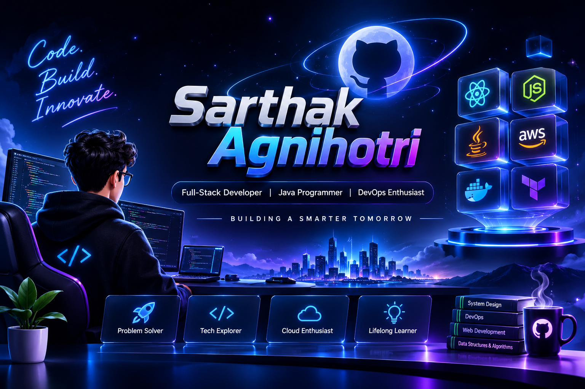

 

  <h1>Hey, I'm Sarthak Agnihotri 👋</h1>

  

   

  

    <b>Building digital experiences. Automating infrastructure. Exploring what's next.</b>
  

  

    Computer Science Student @ Lovely Professional University
  

   

  
  

  

### 🌐 Let's Connect

&nbsp;&nbsp;&nbsp;&nbsp;

&nbsp;&nbsp;&nbsp;&nbsp;

&nbsp;&nbsp;&nbsp;&nbsp;

---

### ⚡ Quick Overview
I build bridge-scale applications between **Development** and **Operations**. Currently focusing on mastering the MERN stack and cloud automation.

- 🔭 **Working on:** Advanced Web Architectures
- 🌱 **Learning:** Kubernetes & Cloud-Native Development
- 💬 **Ask me about:** Java, React, or Docker

---

### 🛠️ Tech Ecosystem

<h2>⚡ TECHNOLOGY UNIVERSE</h2>

<i>The tools I use to build, develop and automate.</i>

 

  

  

---

### 🚀 Featured Work

> [!IMPORTANT]
> ### GST Billing & Management Software
> **Tech:** Java | React | Node.js | MongoDB
> * Built a comprehensive billing system to automate GST calculation and invoice generation.
> * Implemented secure data management for tax compliance and business reporting.

> [!TIP]
> ### Social Network Graph Visualizer
> **Tech:** React | Java | Node.js
> * Engineered an interactive UI to visualize complex data relationships using force-directed graphs.
> * Optimized front-end rendering to handle large datasets and real-time node updates.

---

### 📊 Performance Metrics

  
  

  

---

  

